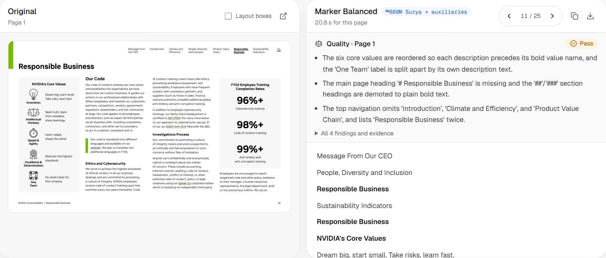
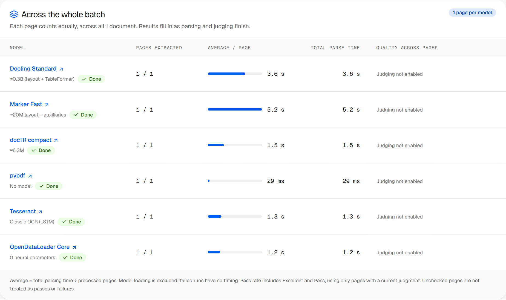
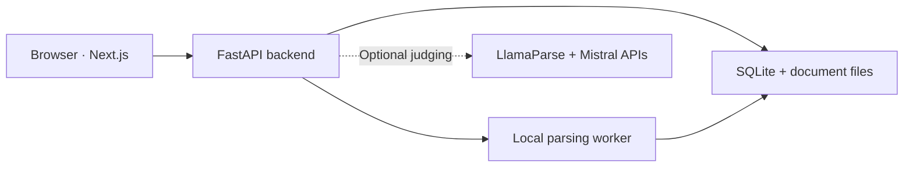

<div align="center">
  
  <h1>Parsing Arena</h1>
  <p><strong>Find the right parser for your documents.</strong></p>
  <p>Compare 24 OCR and parsing methods by output quality and speed.<br>Run locally, inspect every page, and keep your results.</p>
  <p><a href="#run-it-locally">Get started</a> · <a href="#models">Models</a> · <a href="docs/deployment.md">Deployment</a> · <a href="docs/architecture.md">Technical guide</a></p>
</div>



*Original and extraction side by side, with quality feedback. Example: NVIDIA FY2024 Sustainability Report.*

- **A broad selection:** pypdf, tiny OCR networks, Docling, Marker and vision-language models.
- **Your documents, page by page:** preview PDFs or images and select up to **12 unique pages across multiple documents**.
- **Compare directly:** switch models, inspect rendered or raw Markdown, view layout boxes and download outputs.
- **Quality and speed together:** page timings, batch averages, and optional **Excellent / Pass / Fail** assessments with short feedback.
- **Saved results:** reopen runs and prepared samples without repeating extraction. Local parsing needs no API keys.

<details>
<summary><strong>See the batch overview: coverage, timings and saved results</strong></summary>



*Every page counts equally in the batch overview. These are example runs; timings and assessments depend on the document, preset and hardware.*

</details>

## Run it locally

### CPU containers — the easiest start

Install [Docker with Compose](https://docs.docker.com/compose/install/), then:

```bash
git clone https://github.com/yannikgaebel/ocr-arena.git
cd ocr-arena
docker compose up --build -d
```

Open **http://localhost:3000**. Upload a document, select pages and methods, and start the run.

**No Python setup or API keys required.** The images include the parser environments,
Java, Tesseract and native inference tools. **19 methods are enabled in CPU mode**;
five especially slow presets are disabled.

The images target **Linux x86-64 / AVX2**, including Docker Desktop's Linux/WSL2 backend
on Windows. ARM/Apple Silicon images are not provided. For larger models, plan for
**8 CPU threads, 32 GB RAM and 50+ GB free disk**; needs vary by workload.
The first build takes time, and weights download on first use. Larger models can take
minutes per page on CPU, so start with one page and a few methods. Documents, results
and model caches persist in Docker volumes.

```bash
docker compose stop                        # Stop; keep saved data
docker compose up -d                       # Start again
docker compose logs -f                     # View logs
```

<details>
<summary><strong>Linux with an NVIDIA GPU</strong></summary>

Install a compatible NVIDIA driver and the
[NVIDIA Container Toolkit](https://docs.nvidia.com/datacenter/cloud-native/container-toolkit/install-guide.html),
then run from the repo root:

```bash
docker compose -f compose.yaml -f compose.nvidia.yaml up --build -d
docker compose -f compose.yaml -f compose.nvidia.yaml exec backend python /opt/arena/check-install.py --smoke
```

Use both Compose files for subsequent commands. This image uses CUDA 12.8 and
PyTorch 2.11.0; GPU compatibility and memory determine which workloads fit.
Its first build can take an hour or more and needs additional disk space.
The image builds and passes packaging checks; **actual NVIDIA inference still needs
validation on the target GPU**. See the [deployment guide](docs/deployment.md).

</details>

<details>
<summary><strong>Windows / AMD — native GPU setup</strong></summary>

For **Radeon 8060S / Ryzen AI Max (`gfx1151`)**, the native setup uses ROCm and Vulkan.
The CPU Docker image does not accelerate models on an AMD GPU.

Install signed **Python 3.13** with the `py` launcher, **Node.js 22 LTS**,
[uv](https://docs.astral.sh/uv/getting-started/installation/), and the compatible AMD driver:

```powershell
powershell -NoProfile -ExecutionPolicy Bypass -File .\scripts\setup-windows.ps1 -Profile windows-amd
powershell -NoProfile -ExecutionPolicy Bypass -File .\scripts\start-windows.ps1
```

The installer prepares both Python environments and the frontend. Other AMD GPU
families require their own compatible driver/PyTorch setup.
[Prerequisites, logs and troubleshooting →](docs/deployment.md#windows--amd)

</details>

### Optional automatic judging

Enable **LlamaParse Agentic Plus** in Run settings. The confirmation dialog lets you
enter and save missing **LlamaParse and Mistral API keys**, then asks you to type **OK**
before proceeding. Judging is off by default and uses the providers' API credits.

**LlamaParse receives the full uploaded document** to process the selected pages;
**Mistral receives the extracted reference and model text**. Only enable this when
you may share that content. The CPU switch does not change these external transfers.
Assessments are relative to the reference, which can also contain errors.

**Shared server or Kubernetes?** See [deployment, persistent storage and access control](docs/deployment.md).
**Want samples?** [Prepare a saved sample gallery](docs/architecture.md#saved-sample-gallery);
new installations start with an empty gallery.

## Models

**24 local methods + one optional hosted reference**, roughly ordered by size.
The app shows each method's strengths and its actual execution hardware.

| Model | Approximate size | Strengths & use cases | License |
| --- | --- | --- | --- |
| LlamaParse Agentic Plus (optional reference API) | Hosted API | Complex tables & charts; judging reference | Commercial API |
| Unlimited-OCR 2 | 3.3B | Reads multiple pages together with shared context | MIT |
| Infinity-Parser2-Flash | ≈2B | Chart data as tables & scientific page layouts | Apache-2.0 |
| rakedoc-nano | 1.2B | Merged cells & complex table headers | AGPL-3.0 |
| Aeddix Alpine OCR | 1.2B | Tables & inline text formatting | Apache-2.0 |
| florin-parser-nano | 1.2B | Preserves bold, strikethrough & superscripts | AGPL-3.0 |
| MinerU2.5-Pro-2605 | 1.2B | Formulas, charts & technical diagrams | Apache-2.0 (weights) |
| GLM-OCR 0.9B | 900M | Compact full-page text recognition | MIT |
| OvisOCR3 | 850M | Joins tables across pages & extracts chart data | Apache-2.0 |
| LightOnOCR-3-0.8B | 800M | Charts & page layout in one pass | Apache-2.0 |
| Marker Balanced | ≈689M + auxiliaries | Scanned pages, tables & inline math | GPL-3.0 (code), OpenRAIL (Surya weights) |
| Nemotron SkyVision CPU | 631M | Structured document extraction on CPU | OpenMDW-1.1 |
| Docling Standard | ≈300M | Reading order, page structure & tables | MIT (code), Apache-2.0 / CDLA (models) |
| OpenDataLoader Docling | Backend-dependent | Mixed digital/scanned PDFs with German/English OCR | Apache-2.0 (code), model-specific weights |
| Granite Docling 258M | 258M | Tables, equations & page structure in a compact model | Apache-2.0 |
| docTR Large transformer | ≈110.6M | Accuracy-focused text recognition | Apache-2.0 |
| PaddleOCR Medium | 34.5M | Multilingual, screen & scene text | Apache-2.0 |
| docTR default | ≈26.4M | Balanced OCR for printed documents | Apache-2.0 |
| Marker Fast | ≈20M + auxiliaries | Digital PDFs; embedded text, no OCR | GPL-3.0 (code), model-specific weights |
| PaddleOCR Small | 7.7M | Lightweight multilingual text OCR | Apache-2.0 |
| docTR compact | ≈6.3M | Text detection & recognition with low compute needs | Apache-2.0 |
| PaddleOCR Tiny | 1.5M | Tiny multilingual text OCR | Apache-2.0 |
| pypdf | No model | Embedded PDF text; no OCR | BSD-3-Clause |
| Tesseract | Classic OCR (LSTM) | Clean scans of printed text | Apache-2.0 |
| OpenDataLoader Core | No neural model | Digital PDF structure; no OCR | Apache-2.0 |

Sizes are approximate; pipelines may include auxiliary models. Strengths describe
use cases, not a ranking. Code and model weights can have different licenses.

CPU mode disables **Infinity-Parser2-Flash, Aeddix Alpine OCR, GLM-OCR,
florin-parser-nano and docTR Large transformer** because of long processing times.

These are defined presets. Frameworks such as Docling and Marker support further
tuning; results describe the configurations used here.
[Exact configurations, outputs and limitations →](docs/model-presets.md)

## How it works



- **Two services:** a Next.js frontend and a FastAPI backend. Local methods run sequentially; model loading is measured separately from parsing.
- **Separate quality checks:** up to four Mistral checks run concurrently, with retries. Judging time is excluded from OCR timings.
- **Persistent results:** SQLite stores runs and assessments; files and model caches live in persistent storage. Partial extraction and missing judgments remain visible.
- **One shared installation:** use one backend replica/worker. Add authentication and TLS before sharing it; separate user workspaces are not implemented.

“Local” means the machine hosting the backend. Runtime labels distinguish **CPU,
AMD ROCm, AMD Vulkan, NVIDIA CUDA**, configured remote servers, and the hosted API.

## Further details

- [Deployment & configuration](docs/deployment.md) — storage, API keys, image distribution, Kubernetes and runtime profiles.
- [Model presets](docs/model-presets.md) — exact pipelines, output formats, hardware paths and limitations.
- [Architecture & development](docs/architecture.md) — timing and judging rules, saved samples, API and developer checks.
